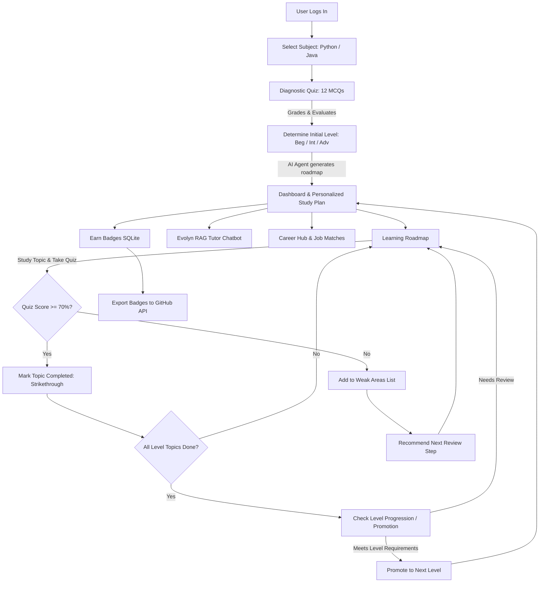

# Evolyn AI Tutor: Adaptive AI-Powered Learning & Developer Onboarding

Evolyn is a modern, enterprise-ready B2B/B2C SaaS platform designed to automate programming curricula delivery, developer onboarding, and technical upskilling. By integrating a dynamic placement assessment, personalized roadmaps, gamified achievements, and a hallucination-free **Retrieval-Augmented Generation (RAG)** chatbot, Evolyn offers students and developers a tailored educational path that adapts to their skill levels in real time.

---

## 🗺️ System Architecture & Dataflow

Below is the dynamic flowchart representing the trainee onboarding, adaptive study path, RAG bot interaction, and promotion cycle:



---

## 🌟 Core Features

### 1. Dynamic Onboarding & Placement Quiz
- Trainees complete a **12-question diagnostic quiz** (4 Beginner, 4 Intermediate, 4 Advanced) dynamically generated by GPT-4o-mini from localized knowledge bases.
- The backend evaluates mastery per difficulty level, automatically assigning the user their optimal starting tier (**Beginner**, **Intermediate**, or **Advanced**).

### 2. Personalized Roadmap & Weak Areas Logging
- Renders an interactive checklist of topics matching the assigned level.
- Topics with a passing score average $\ge 70\%$ are crossed out dynamically using robust string-normalization logic.
- Challenging topics are routed to a **Weak Areas** log for focused remediation before level advancement is permitted.

### 3. Hallucination-Free RAG Assistant
- Powered by **LangChain** and a local **FAISS Vector Database** pre-loaded with verified language documentation.
- The assistant is strictly grounded, ensuring that code explanations are secure, 100% accurate, and compliant with coding guidelines.

### 4. Verified GitHub Badging
- Integrates with the GitHub API to allow users to link their GitHub accounts.
- Accomplishments (e.g. course completion, clearing all weak areas) award digital badges that can be exported directly to the user's GitHub profile.

### 5. Career Hub
- Suggests career categories and job descriptions matched with the student's proved skill levels and course progress metrics.

---

## 🛠️ Technology Stack

* **Frontend:** React 18, Vite, CSS, React Context APIs.
* **Backend:** FastAPI (Python 3.10), SQLite, Uvicorn.
* **AI & Search:** LangChain, FAISS Vector Store, OpenAI GPT-4o-mini.
* **Deployment:** Render cloud platforms.

---

## 💻 Local Installation & Setup

### Prerequisites
- Python 3.10+
- Node.js 18+
- OpenAI API Key

### 1. Clone the Repository
```bash
git clone https://github.com/Wajdall/AI-tutoring-agent.git
cd AI-tutoring-agent
```

### 2. Configure Environment Variables
Create a `.env` file in the root directory:
```env
OPENAI_API_KEY=your_openai_api_key_here
SECRET_KEY=your_jwt_secret_key_here
PORT=8000
```

### 3. Run Backend FastAPI Server
Set up virtual environment and run the server:
```bash
# Create and activate virtual environment
python -m venv .venv
source .venv/bin/activate # On Windows use: .venv\Scripts\activate

# Install dependencies
pip install -r requirements.txt

# Run server
python server.py
```
The backend API will run at `http://localhost:8000`.

### 4. Run Frontend React App
Open a new terminal window:
```bash
cd frontend

# Install package dependencies
npm install

# Start development server
npm run dev
```
The React frontend will run at `http://localhost:5173`.

---

## 🌐 Deployed Services
- **Backend API:** `https://ai-tutoring-agent.onrender.com`
- **Frontend App:** `https://ai-tutoring-agent-evolyn.onrender.com`
- **Project Report:** [Evolyn Final Report (PDF)](docs:///03_Project_Report/Evolyn_AI_Tutor_Group01_Report_v1.pdf)
